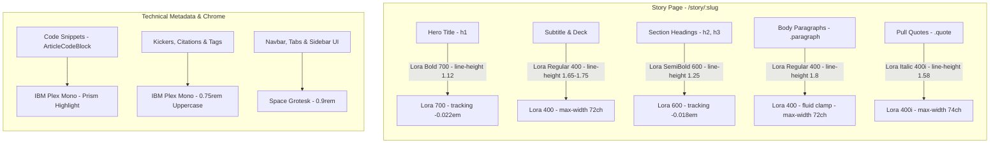

# Editorial Typography & Lora

Kalidass Journal pairs classical literary design with modern AI-native engineering. For long-form reading and deep technical briefs, typography directly dictates reader comprehension, visual fatigue, and editorial authority.

This document details the web research, industry benchmarks, and implementation architecture behind selecting and configuring the **Lora** typeface for the story reader.

---

## 1. Typographic Identity & Stack

Kalidass Journal maintains a calibrated multi-tier typographic system balancing classical Sanskrit/Victorian editorial poise against sharp technical metadata:

| Role | Typeface | Classification | Fallback Stack | Purpose & Scope |
| :--- | :--- | :--- | :--- | :--- |
| **Story Narrative** | **Lora** | Calligraphic Serif | `Georgia, serif` | Narrative story text: hero headline, subtitle, deck, section headings, quotes, and prose paragraphs. |
| **Masthead & Display** | **Source Serif 4** | Baroque Serif | `Georgia, serif` | Journal masthead and global page headers. |
| **UI & Systems** | **Space Grotesk** | Geometric Sans | `-apple-system, BlinkMacSystemFont, "Segoe UI", sans-serif` | Navigation bar, buttons, tabs, article card headers, and form inputs. |
| **Code & Intelligence** | **IBM Plex Mono** | Monospace | `ui-monospace, SFMono-Regular, monospace` | Pre-formatted code blocks, kickers, citation badges, and arXiv metadata chips. |

---

## 2. Research & Industry Benchmarks

To establish the optimal configuration for Lora, we benchmarked contemporary long-form digital publications—including *Medium*, *Substack*, *The Atlantic*, *The New Yorker*, and Robert Bringhurst's *The Elements of Typographic Style*.

### A. Font Size & Optical Scaling
- **The Challenge**: Standard web fonts set at 16px appear compact and strenuous during 10+ minute reading sessions. Conversely, oversized text (>21px) induces excessive vertical eye movement.
- **The Sweet Spot**: Lora possesses a moderate x-height with gentle ascenders. The optimal desktop reading scale is **18px to 19px** (`1.125rem` to `1.18rem`).
- **Responsive Scale**: Implemented using a fluid CSS clamp:
  ```css
  font-size: clamp(1.08rem, 1rem + 0.35vw, 1.18rem);
  ```
  This automatically transitions from ~17.3px on mobile viewports to ~19px on high-DPI desktop screens.

### B. Vertical Rhythm & Leading (Line Height)
- **Ratio**: Unitless ratio of **1.8** for body prose (e.g., 34.2px leading on a 19px font).
- **Rationale**: Dense line height (e.g., 1.4–1.5) causes lines of text to visually bleed together during multi-paragraph essays. A leading of 1.8 provides ample white space between lines, allowing the eye to track back to the left margin effortlessly.
- **Headings & Titles**: Tighter ratio of **1.12 to 1.25** ensures large multi-line titles remain cohesive rather than disjointed.

### C. The Golden Measure (Line Length)
- **Bringhurst's Rule**: 60 to 75 characters per line (including spaces) is the cognitive ideal for continuous reading.
- **Implementation**: Bounded via `max-width: 72ch` on all `.paragraph` and `.deck` blocks.
- **Layout Depth**: Restricting prose to `72ch` while allowing wide-format figures, code snippets, and videos to span the full card width introduces rich editorial pacing.

### D. Tracking (Letter Spacing) & Optical Kerning
- **Prose Paragraphs**: Micro-tracking of `+0.006em`. Avoids harsh gaps while ensuring clean letter separation on low-DPI displays.
- **Display Headlines**: Tighter tracking of `-0.018em` to `-0.022em`. Pulls large capital letters together, preventing loose negative space.

### E. OpenType Features
- Standard ligatures (`fi`, `fl`, `ff`) and contextual kerning pairs are explicitly activated:
  ```css
  text-rendering: optimizeLegibility;
  font-feature-settings: "kern" 1, "liga" 1, "calt" 1;
  -webkit-font-smoothing: antialiased;
  ```

---

## 3. Typographic Hierarchy Architecture



---

## 4. Implementation & Design Tokens

### Global Font Imports (`blog_frontend/src/css/custom.css`)

```css
@import url("https://fonts.googleapis.com/css2?family=IBM+Plex+Mono:ital,wght@0,400;0,500;0,600;1,400&family=Lora:ital,wght@0,400;0,500;0,600;0,700;1,400;1,600&family=Source+Serif+4:ital,opsz,wght@0,8..60,400;0,8..60,600;0,8..60,700;1,8..60,400;1,8..60,600&family=Space+Grotesk:wght@400;500;600;700&display=swap");

:root {
  --font-display: "Source Serif 4", Georgia, serif;
  --font-story: "Lora", Georgia, serif;
  --font-sans: "Space Grotesk", -apple-system, BlinkMacSystemFont, "Segoe UI", sans-serif;
  --font-mono: "IBM Plex Mono", ui-monospace, SFMono-Regular, monospace;
}
```

### Component Rules

- **`StoryBody.module.css`**: Controls `.body`, `.paragraph`, `.heading`, and `.quote` rules.
- **`StoryPage.module.css`**: Controls `.heroCopy h1`, `.sub`, and `.deck` rules.

---

## 5. Licensing & Commercial Usability

- **License**: [SIL Open Font License (OFL) Version 1.1](https://openfontlicense.org/).
- **Commercial Freedom**: 100% free for commercial and non-commercial web applications, digital magazines, print, and mobile software.
- **Zero Royalties**: No recurring license fees, pageview restrictions, or required front-facing attributions.
- **Edge CDN Delivery**: Delivered via Google Fonts edge caches with `display=swap` to eliminate flash of invisible text (FOIT).
