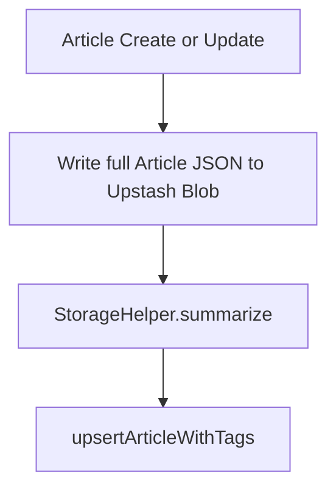
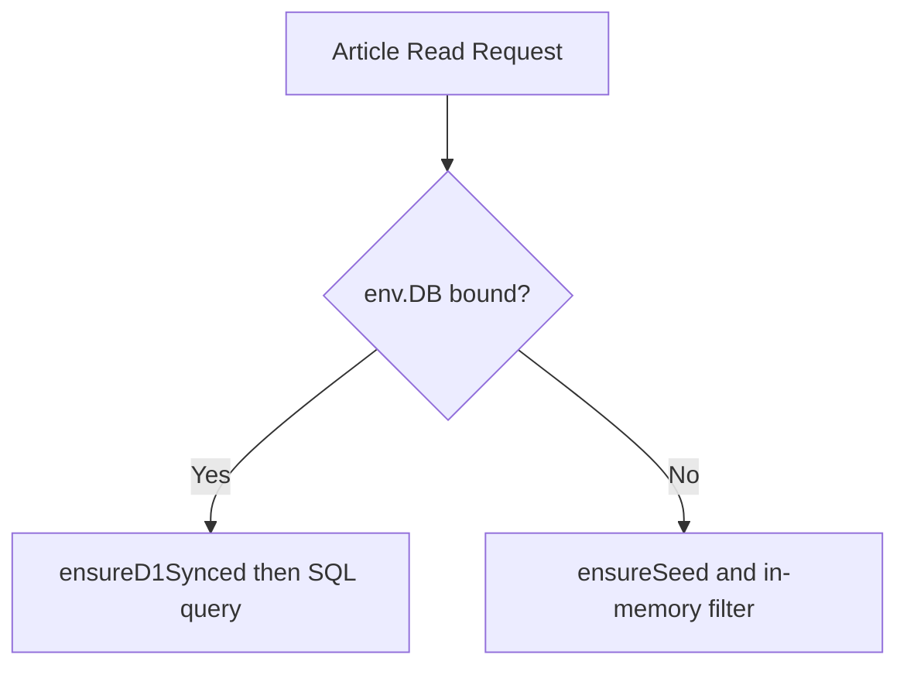

# Cloudflare D1 Catalog

The worker maintains a **Cloudflare D1** (edge SQLite) **catalog** that mirrors article summaries for fast relational
queries — feed pagination, tag filtering, author scoping, and slug uniqueness. D1 is a **read index**, not the source of
truth: the full `Article` JSON still lives in Upstash Blob, and each D1 row carries a denormalized copy of its summary.

When the `DB` binding is absent, every route transparently falls back to the original Blob-only path.

## Role in the Stack

| Layer | Stores | Authority |
| --- | --- | --- |
| **Upstash Blob** | Full `Article` JSON at `<root>/articles/<id>.json`, plus media | **Source of truth** — durable, survives restarts |
| **Cloudflare D1** | `articles` + `article_tags` rows (denormalized `ArticleSummary`) | Query catalog — rebuilt/synced from Blob |
| **Upstash Redis** | Feed, story, tags, dossier caches | Acceleration only, TTL-bound |

## Binding & Configuration

D1 is declared in `worker/wrangler.toml`:

```toml
[[d1_databases]]
binding = "DB"
database_name = "kalidass-journal-db"
database_id = "f6bd6f4f-bf62-47c4-8fac-18614ab4f12c"
migrations_dir = "migrations"
```

<Tree>
  <Tree.Folder name="worker" defaultOpen>
    <Tree.Folder name="src" defaultOpen>
      <Tree.Folder name="d1" defaultOpen>
        <Tree.File name="repository.js" highlight />
      </Tree.Folder>
      <Tree.File name="index.js" />
    </Tree.Folder>
    <Tree.Folder name="migrations" defaultOpen>
      <Tree.File name="0001_init_d1_schema.sql" highlight />
    </Tree.Folder>
    <Tree.File name="wrangler.toml" highlight />
  </Tree.Folder>
</Tree>

Apply the schema before deploying:

```bash
# Remote (production) — from the worker/ directory
npx wrangler d1 migrations apply kalidass-journal-db --remote

# Local emulation for wrangler dev
npx wrangler d1 migrations apply kalidass-journal-db --local
```

## Schema (`migrations/0001_init_d1_schema.sql`)

### `articles`

| Column | Type | Notes |
| --- | --- | --- |
| `id` | `TEXT` | Primary key (matches the Blob article id). |
| `slug` | `TEXT` | **`UNIQUE NOT NULL`** — enforces slug uniqueness at the database level. |
| `title` | `TEXT` | Searchable title. |
| `author_email` | `TEXT` | Immutable creator email (ownership scoping). |
| `published` | `INTEGER` | `1` = published, `0` = draft. |
| `private` | `INTEGER` | `1` = unlisted, `0` = public. |
| `featured` | `INTEGER` | `1` = lead story. |
| `read_time` | `INTEGER` | Estimated minutes. |
| `published_at` / `updated_at` | `TEXT` | ISO timestamps used for ordering. |
| `summary` | `TEXT` | JSON-encoded `ArticleSummary` (see [Data Model](/data-model)). |

### `article_tags`

| Column | Type | Notes |
| --- | --- | --- |
| `article_id` | `TEXT` | Foreign key → `articles.id` (`ON DELETE CASCADE`). |
| `tag` | `TEXT` | `COLLATE NOCASE` — case-insensitive matching. |

Composite primary key `(article_id, tag)`.

### Indexes

| Index | Columns | Serves |
| --- | --- | --- |
| `idx_articles_feed` | `(published, private, published_at DESC)` | Public feed ordering. |
| `idx_articles_author` | `(author_email, published, updated_at DESC)` | Author/status scoping. |
| `idx_tags_lookup` | `(tag)` | Tag-filtered feed queries. |

## Repository API (`src/d1/repository.js`)

| Function | Purpose |
| --- | --- |
| `ensureD1Synced(db, storage, env, seedFallback)` | One-time cold-start seeding of D1 from Blob (or the seed list) when the catalog is empty. |
| `getPublicArticles(db, { tag, page, limit, search })` | Public feed query — filters `published = 1 AND private = 0`, optional tag (`COLLATE NOCASE`) and escaped `LIKE` search across title/excerpt/subtitle, ordered by `published_at DESC` with offset pagination. Returns parsed summaries. |
| `getAuthorArticles(db, user, status)` | Owner/admin scoping for `?status=` queries (`draft`, `published`, `all`). |
| `getTopTags(db, redis)` | Top 10 tags by article count (published, non-private), Redis-cached. |
| `isSlugTaken(db, slug, excludeId)` | Pre-flight slug collision check (excludes the article being updated). |
| `getArticleByIdOrSlug(db, key)` | Resolves `{ id, summary }` by id or slug for sub-resource gating. |
| `upsertArticleWithTags(db, record, summary)` | Upserts the article row and rewrites its tag rows in a single batch. |
| `deleteArticle(db, id)` | Deletes the article row and its tag rows (cascade). |
| `clearAllD1Articles(db)` | Empties both tables and resets the sync flag (admin reset). |

`resetSyncStateForTesting()` clears the module-level sync flag for hermetic tests.

## Sync Lifecycle

D1 stays consistent with Blob through a small lifecycle rather than per-read recomputation:

1. **Cold start** — `ensureD1Synced` runs before any D1 read (`/api/tags`, public `/api/articles`, status queries,
   `/api/generate`). If `articles` is empty, it reconstructs the index from Blob via `StorageHelper.reconstructIndex`
   (falling back to `seedArticles`), inserts rows in batches of 20, and sets a module-level `isSynced` flag. If nothing is
   seeded the flag stays unset so a later request retries.
2. **Mutations** — `POST`/`PUT /api/articles` call `upsertArticleWithTags` after writing the Blob object; `DELETE`
   calls `deleteArticle` (plus the Blob `del`).
3. **Admin maintenance** — `POST /api/admin/reset` empties D1 and purges caches; `POST /api/admin/reindex` rebuilds the
   catalog from Blob.



## Tag Ranking & Caching

`getTopTags(db, redis)` returns the 10 most-used tags across published, non-private articles:

- It first attempts the Redis key `tags:top10` (3-hour TTL).
- On a miss it runs `SELECT tag, COUNT(*) ... GROUP BY tag ORDER BY count DESC LIMIT 10` over `article_tags` joined to
  `articles`, then writes the result back to Redis.
- Exposed publicly as **`GET /api/tags`** (returns `string[]`, `cache-control: public, max-age=60, stale-while-revalidate=120`)
  and consumed by the frontend via `getTopTags()` in `src/lib/api.ts`.

## Blob Fallback

Every D1 read is guarded by `if (env.DB)`. When the binding is absent (local dev without D1, or hermetic tests), the
worker uses the original path: `StorageHelper.ensureSeed(bucket, env)` loads the index from Blob and filtering, tag
matching, and status scoping run in memory, with `withIndexLock` + `uniqueSlug` providing the uniqueness guarantees that
D1's `UNIQUE` constraint provides otherwise.


