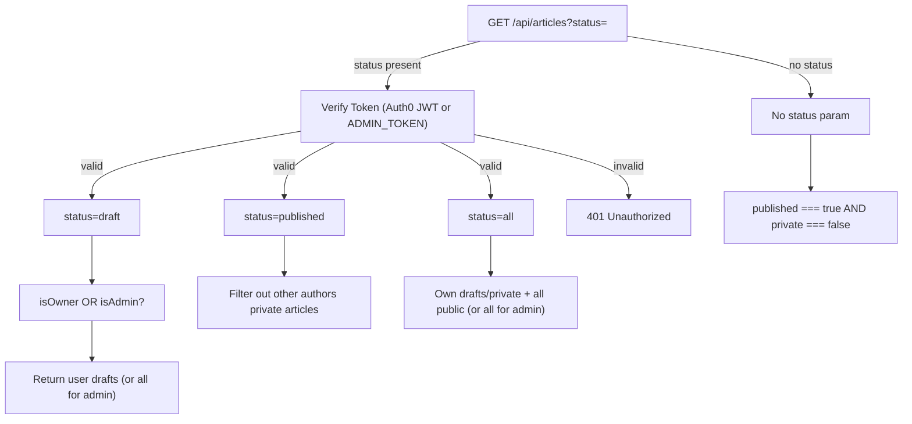

# Request Routing

The worker's `fetch` handler processes every incoming request by inspecting `url.pathname` and `request.method`. Routes are evaluated in declaration order. All responses include CORS headers derived from `CORS_ORIGIN`. Article reads are served from the **Cloudflare D1 catalog** when the `DB` binding is present, falling back to the Blob-backed index otherwise (see [Cloudflare D1 Catalog](/worker/d1)).

## CORS Handling

Every response carries access-control headers generated by `ResponseHelper.corsHeaders(origin)`:

```js
{
  "access-control-allow-origin": origin,
  "access-control-allow-methods": "GET,POST,PUT,DELETE,OPTIONS",
  "access-control-allow-headers": "content-type,authorization,x-admin-token,x-typesafe-key,x-jev-key,x-clef-key,x-eval-provider,x-cf-model",
  "access-control-max-age": "86400"
}
```

`OPTIONS` preflight requests receive an immediate `204` via `ResponseHelper.options(origin)` with no further processing.

## Route Table

| Method | Path | Auth Required | Handler | Description |
| --- | --- | --- | --- | --- |
| `OPTIONS` | `*` | No | `options(origin)` | CORS preflight — returns `204` immediately. |
| `GET` | `/api/blob/:path` | **Yes** | Memory object lookup | Serves in-memory blob bytes. Only active when no `UPSTASH_BLOB_TOKEN` is set. Requires authenticated author or admin. |
| `GET` | `/api/upload` | **Yes** | `uploadsFor(env).GET` | Returns Upstash Blob upload token for direct browser upload. Requires `UPSTASH_BLOB_TOKEN` and authenticated author or admin. |
| `POST` | `/api/upload` | **Yes** | `uploadsFor(env).POST` | Handles direct browser upload to Upstash Blob. Requires `UPSTASH_BLOB_TOKEN` and authenticated author or admin. |
| `GET` | `/api/health` | No | Inline | Health check — returns `{ ok: true }` with status `200`. |
| `GET` | `/api/auth/me` | **Yes** | `getAuthUser` | Returns authenticated user profile `{ user: { email, role, sub, isSuperuserEligible } }`. |
| `POST` | `/api/auth/elevate` | **Yes** | Inline verification | 2-Factor elevation. Requires whitelisted email (`ADMIN_EMAILS`) and valid `adminToken` body. Returns `{ ok: true, elevated: true }`. |
| `POST` | `/api/objects` | **Yes** | Inline multipart | Media upload via `FormData`. Accepts `file` field. Max `20mb`; images (WebP/JPEG) capped at 500 KB. Requires authenticated author or admin. |
| `GET` | `/api/tags` | No | `getTopTags` | Top 10 tags from the D1 catalog (published, non-private), Redis-cached under `kalidass:tags:top10` (3h). Returns `string[]`. |
| `POST` | `/api/eval/quality` | **Yes** | `runQualityEvaluation` | Evaluates AI detection, accuracy, engagement, and safety. Requires Bearer token. |
| `POST` | `/api/generate` | **Yes** | `generateArticle` | Autonomous Upstash Box article authoring & gpt-image-1 cover infographic synthesis. Requires Bearer token. |
| `POST` | `/api/admin/reset` | **Yes** | Inline reset | Empties the D1 catalog (`clearAllD1Articles`) and Blob index, then purges all caches. Requires Super-Admin Bearer token. |
| `POST` | `/api/admin/reindex` | **Yes** | `reconstructIndex` | Rebuilds the catalog from stored article objects under `withIndexLock`, upserts every row into D1, invalidates all caches, and returns the rebuilt count. Requires Super-Admin. |
| `GET` / `POST` | `/api/ai_search_insight` | **Yes** | Inline SerpApi | Live Google AI Overview lookup for an ad-hoc query (`q` / `query` param or body field). Returns `{ ok, query, ai_overview, organic_results, search_metadata }`. |
| `GET` | `/api/articles` | Conditional | `getPublicArticles` (D1) + Redis feed cache | Public feed served from D1 (tag / `q` search / `page` params) and cached in Redis (3h TTL, `kalidass:feed:public`) with deterministic featured story. Evaluates `If-None-Match` returning `304 Not Modified` on ETag match. Falls back to the Blob index when `DB` is unbound. `?status=` queries require auth and bypass cache. |
| `GET` | `/api/articles?status=draft` | **Yes** | `getAuthorArticles` (D1) | Returns drafts belonging to authenticated user (`authorEmail === user.email`), or all drafts for admin. |
| `GET` | `/api/articles?status=published` | **Yes** | `getAuthorArticles` (D1) | Returns published articles (excluding other authors' private unlisted articles unless admin). |
| `GET` | `/api/articles?status=all` | **Yes** | `getAuthorArticles` (D1) | Returns all accessible articles (scoped by author email for non-admins). |
| `POST` | `/api/articles` | **Yes** | `buildArticle` + D1 slug check + `upsertArticleWithTags` | Creates article stamped with immutable `authorEmail`. Enforces slug uniqueness (`409` on D1 `UNIQUE` violation). Syncs D1 and purges Redis feed keys. Returns `201` with full `Article`. |
| `GET` | `/api/articles/:idOrSlug` | Conditional | `readJson` + Redis story cache | Public articles cached in Redis (24h TTL, `kalidass:article:<id>`, `kalidass:slug:<slug>`). Draft **or private** articles bypass cache, requiring author or admin auth (returns `404` otherwise). |
| `GET` | `/api/articles/:idOrSlug?intelligence=true` | **Yes** | `getOrGenerateArticleIntelligence` | Compiles/refreshes live SerpApi search intelligence in Upstash Box; purges cached article in Redis to unfreeze `has_intelligence`. Requires author ownership or admin. |
| `GET` | `/api/articles/:idOrSlug/intel` | Conditional | `peekArticleIntelligence` | Public read-only intelligence sub-resource (Redis/Blob only, never spawns Box). Gated by article draft/private state. |
| `GET` | `/api/articles/:idOrSlug/books` | Conditional | `peekArticleBooks` | Public read-only book-suggestion sub-resource (Redis → Blob only, never generates). Gated by article draft/private state; `404` when none compiled. |
| `POST` | `/api/articles/:idOrSlug/books` | **Yes** | `getOrGenerateArticleBooks` | Generates/refreshes Amazon book suggestions via SerpApi and the eval scorer. Owner or admin only; returns `201`. |
| `GET` | `/api/articles/:idOrSlug?books=true` | **Yes** | `getOrGenerateArticleBooks` | Inline variant returning the article with an embedded `books_suggestions` payload; honors `refresh=true`. |
| `PUT` | `/api/articles/:idOrSlug` | **Yes** | `buildArticle` merge + D1 upsert | Updates existing article, syncs D1, and purges article, slug, and feed Redis caches. Returns `403 Forbidden` if requester is not author or admin, `409` on slug collision. Preserves `authorEmail`. |
| `DELETE` | `/api/articles/:idOrSlug` | **Yes** | `deleteArticle` (D1) + `bucket.del` | Deletes the article from D1 and Blob and purges Redis caches. Returns `403 Forbidden` if requester is not author or admin. |
| `*` | `*` | No | Inline | Catch-all — returns `404 { error: "Not found" }`. |

## Status Filter Logic



## Authentication & Authorization

Authentication is resolved by `AuthHelper.getAuthUser(request, env)`:

1. **Auth0 JWT Verification**: If `AUTH0_DOMAIN` is configured, incoming `Authorization: Bearer <jwt>` tokens are verified against Auth0's remote JWKS (`https://<AUTH0_DOMAIN>/.well-known/jwks.json`) using `jose`. The verified payload resolves `user.email` (with Auth0 `/userinfo` endpoint fallback if claims are omitted from the access token) and evaluates `isSuperuserEligible` against `ADMIN_EMAILS`.
2. **2-Factor Superuser Elevation (`X-Admin-Token`)**:
   - For an authenticated author, `role: "admin"` is granted **only** when `isSuperuserEligible` is `true` **and** the `x-admin-token` header matches `ADMIN_TOKEN` via constant-time SHA-256 + `timingSafeEqual`.
   - Any attempt to elevate by non-whitelisted emails is rejected with `403 Forbidden` at `/api/auth/elevate` and ignored by `getAuthUser`.
3. **Admin Token Fallback**: If `ADMIN_TOKEN` matches the Bearer token directly (verified in constant time), the request is granted full Super-Admin status (`role: "admin"`) for automated M2M publishing.
4. **Role & Ownership Gates**:
   - **Super-Admin (`role: "admin"`)**: Can view, edit, draft, and delete any article across all users.
   - **Author (`role: "author"`)**: Can create articles (stamped with their verified `authorEmail`), view/edit their own drafts and private articles, but receives `403 Forbidden` when attempting to mutate articles authored by other users.

## Error Handling

All unhandled exceptions in the fetch handler are caught by a top-level `try/catch` that returns a `500` JSON response:

```json
{ "error": "<error message>" }
```
